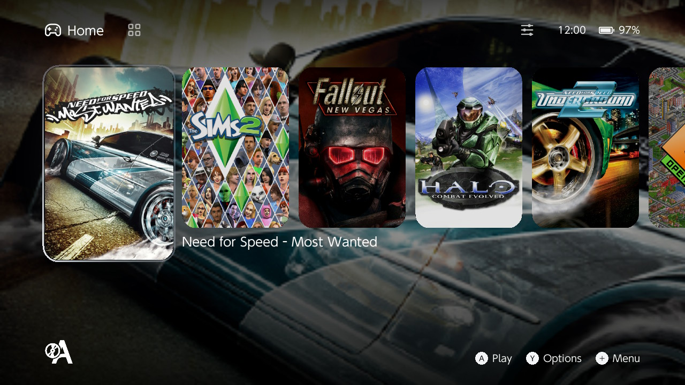

<p align="center">
  
</p>

<h1 align="center">Autorun</h1>

<p align="center">
  Play Windows PC games on your Nintendo Switch.<br>
  <sub>Previously called Wine-NX.</sub>
</p>

Autorun is a homebrew app that runs Windows games and programs on the Switch.
It brings [Wine](https://www.winehq.org) - the layer that lets Windows software
run outside Windows - to the Switch's own operating system, and translates PC
code for the Switch's ARM processor. You bring the games: copy your own PC
copies to the SD card and start them from Autorun's library.

- **32-bit and 64-bit games.** [FEX](https://github.com/FEX-Emu/FEX) translates
  both x86 and x64 code; [Box64](https://github.com/ptitSeb/box64) is there as a
  second translator for 32-bit programs.
- **The Switch's GPU.** OpenGL and Vulkan come from Mesa 26
  ([mesa-switch](https://github.com/danfromtico/mesa-switch)), and Direct3D 8
  to 11 run through [DXVK](https://github.com/doitsujin/dxvk), Direct3D 12
  through [VKD3D-Proton](https://github.com/HansKristian-Work/vkd3d-proton).
- **Frame generation** with [LSFG-VK](https://git.lsfg-vk.dev/lsfg-vk-archive.git),
  for Vulkan games, with your own copy of Lossless Scaling.
- **The Windows DLLs games need** are downloaded and kept up to date by the app.
- **Game fixes**: the app recognises games that need extra setup on the Switch
  and offers their fix before the game starts. See
  [which games have one](https://github.com/autorunhq/autorun-game-fixes/blob/main/FIXES.md).
- **USB drives** show up in games as drives D: to H:.
- **A launcher** with artwork, per-game settings, controls and HOME menu
  shortcuts for games.

> **Autorun is experimental.** Some games run well, many start and then stop on
> something that isn't done yet. Every run writes a log that says where. A game
> compatibility list is coming.



## Not a piracy or circumvention tool

Autorun runs **your own copies** of PC games. It doesn't include, download or
link to any game, and it doesn't remove or get around copy protection, DRM or
license checks.

Some games do get small changes so they can start at all, and here is why.
Autorun runs Wine inside **a single process** on the Switch: one Windows
program at a time, with everything Wine needs (its server, its registry, its
windows) inside that one homebrew app. Horizon gives a homebrew app no way to
start a second program beside itself. Many PC games start through a second
program: a launcher that checks your hardware, writes a settings file and then
starts the real game, or a store's front end that starts it and waits. On a PC
that hop is invisible. On the Switch the second program can't start next to
the first, and the game just closes. So Autorun, and its
[game fixes](https://github.com/autorunhq/autorun-game-fixes), take the hop out:

- the settings file the launcher would have written is written for it;
- the arguments the launcher would have passed are passed;
- where a game insists on handing itself over to its launcher, the runtime
  skips that one call, in memory, so the game starts directly.

Nothing else in the game is changed, and its own checks run as they always do.

There are two kinds of launcher, and only the first can be handled this way.
One starts the game and goes away: that hop is what's taken out above. The
other has to **keep running beside the game** for as long as it plays: a
store's client such as Steam, the EA app or Ubisoft Connect, which the game
keeps asking whether you own it, and where its overlay and cloud saves come
from. Autorun can't leave a process running like that: there is only the
game's. A game that needs one doesn't start on Autorun as it is, and Autorun
doesn't fake the store's answer. Some players set up their original copy to
start without its client; Autorun doesn't include, link to or support a tool
for that, and doing it is their own decision and responsibility, only ever for
a copy they bought. Games with online sign-in or anti-cheat are out of reach
the same way.

> **No support for pirated, cracked or modified games.** Issues, forum threads
> and logs that come from them are closed without an answer, and links to them
> removed. Autorun and its fixes are made and tested for legitimate,
> unmodified copies.

> **No support for third-party bundles.** Downloads that ship a game already
> packed with Autorun as its environment ("ready to play" packs of a game,
> Autorun and its settings in one archive) aren't made by this project, and we
> don't support or endorse them. They usually carry a game shared without its
> publisher's permission, and often an old or modified Autorun. Get Autorun only
> from its [releases](https://github.com/autorunhq/autorun/releases), and put
> your own copy of the game on the card yourself.

## What you need

- A Nintendo Switch with custom firmware (Atmosphère) that can run homebrew.
- A microSD card with room for Autorun, its Windows DLLs (about 200 MB to
  download) and your games.
- Your games, as installed PC folders.

## Installing

1. Download the latest `autorun-NNN.zip` from
   [Releases](https://github.com/autorunhq/autorun/releases/latest).
2. Unzip it to the **root** of your SD card. Everything goes into
   `switch/wine`.
3. Start **Autorun** from the Homebrew Menu. **Quick setup** runs the first
   time:
   - puts Autorun on the HOME menu, so games get the console's full memory;
   - downloads the Windows DLLs from
     [autorun-horizon-dlls](https://github.com/autorunhq/autorun-horizon-dlls);
   - installs the boot changes some games need: a Mesosphere build that lets a
     game run at low memory addresses, with the stock loader or
     [Horizon-OC](https://github.com/Horizon-OC/Horizon-OC)'s for overclocking.

   **Settings -> System -> Quick setup** runs it again.

Without a network, download that repository (Code, Download ZIP) and unzip its
`switch` folder to the root of the SD card too.

### Updating

**Settings -> System -> Check for update** installs a newer release; your
games, settings and artwork stay. **Settings -> System -> Windows DLLs**
downloads only the DLLs that changed, and **Verify files** checks the card's
copies.

## Adding games

1. Copy the game's folder into `switch/wine/drive_c` on the SD card (that
   folder is the game's `C:` drive), or onto a USB drive.
2. In Autorun, press **+** -> **Add game** and choose the game's `.exe`.
3. Press **A** to play.

Adding a game gives it DXVK, which draws Direct3D through the Switch's Vulkan
driver. To keep new games on Wine's own Direct3D, turn off **Settings -> Give a
new game DXVK**.

Before the first program on a card, Autorun sets up the Windows components a
PC's Windows installation would have registered, such as DirectShow and the MP3
decoder that game movies and music play through. It runs by itself, once.

## Using the launcher

| Button | What it does |
|---|---|
| **A** | Play the selected game |
| **Y** | The game's options |
| **L / R** | Switch between Home (recently played) and the Library |
| **−** | Settings (on Home), filter and sort (in the Library) |
| **+** | Add a game, run a program once without adding it (a setup, a patch), or exit Autorun |

The touchscreen works everywhere too.

**A game's options (Y)**:
- mark it as a favorite or hide it, change its title, give it command-line
  arguments, and download its artwork;
- make a HOME menu shortcut that starts it directly;
- pick how its graphics are drawn (Wine's Direct3D or DXVK), how a picture
  smaller than the screen is enlarged (FSR 1.0, or whole-pixel steps for pixel
  art), and **Frame Generation**;
- pick the CPU translator (FEX or Box64), and give it its own controls.

**Settings (−)**: show hidden games, the controls every game uses by default,
a [SteamGridDB](https://www.steamgriddb.com) API key for artwork, returning to
Autorun when a game ends, updates, the Windows DLLs, and the credits.

### Carafe's builds of DXVK and FEX

Two downloads come from this repository's own releases instead of the projects
that make them: DXVK and FEX with [Carafe](https://github.com/carafe-nx/carafe)'s
patches. Both are in a game's options and neither is on by default.

- **Graphics, DXVK version, DXVK Carafe** lists the releases and installs the
  one you pick, as the other DXVK sources do. **DXVK options** then also shows
  what only this build reads (background pipeline compilation, the Direct3D 9
  front end and effect threads, the frame limiter's methods).
- **Emulation, FEX build, Carafe** does the same for FEX. It is there for 32-bit
  games set to FEX; 64-bit games keep Autorun's FEX. **FEX options** then also
  shows what only this build reads. Choosing **Autorun** again, or pressing the
  reset button on the row, goes back.

They are built by the `carafe dlls` workflow from `carafe/dlls`; a fork that
builds its own has to name itself in `WINE_NX_CARAFE_DLLS_REPO`
(`horizon-wine/source/dxvk_releases.h`).

### Carafe's thread placement

Two more switches under **Emulation** in a game's options come from Carafe, and
both are off until you turn them on:

- **Thread orchestrator** watches how busy each core is. When one core is full
  it gives the busiest thread a core to itself and spreads the other busy
  threads by their load; the rest of the time Autorun's own balancer places
  threads, as it does with the switch off.
- **Lock wait boost** lets a game thread that waits for one of the runtime's
  locks wait one priority higher.

Neither has been measured on a console in this fork yet, so try them per game
and compare. The log says what the orchestrator did in lines that start with
`[ORCHESTRATOR]`.

### Carafe's shared server threads

Every thread of a game has a second thread behind it that answers its requests
to Wine's server, and both count against the number of threads the console
gives an application. **Emulation, Shared server threads** in a game's options
lets the game's threads share a few of those instead, which is Carafe's server
thread pool. It is off until you turn it on, and it works only with
**Synchronization** set to **Horizon**; the row is greyed out otherwise. It is
meant for games that start many threads. It has not been tried on a console in
this fork yet.

The log says which is in use in the line `[SYNC] server threads: ...`. The
`[BUDGET]` line, written about every 30 seconds, has the pool in its `pool=` field:
its threads, how many of them are idle and how many are waiting inside a
request.

### The settings menu in the console's language

The settings menu over a running game follows the console's language. Its
settings, values and pages used to be English only; they now carry Carafe's
texts in Russian, Simplified and Traditional Chinese, Japanese, Korean,
French, Canadian French, German, Italian, Spanish, Latin American Spanish,
Dutch, Portuguese and Brazilian Portuguese, for the settings both menus have:
91 of the 141, with their values. What only Autorun has stays English there
(among it 26 DXVK and 10 FEX options), and English itself reads as before. A
console set to any other language gets English. The launcher is English only.

The menu also has the rows that came with Carafe's parts: **DXVK build** offers
**DXVK Carafe**, **FEX build** chooses between Autorun's and Carafe's, and
**Shared server threads**, **Thread orchestrator** and **Lock wait boost** are
there as in a game's options. An option of DXVK or FEX is listed only while the
build chosen in the menu reads it. None of this has been seen on a console yet.

### Frame generation

LSFG-VK doubles the frame rate of Vulkan games (DXVK and VKD3D-Proton count) by
drawing a frame between each two the game draws. It needs Lossless Scaling's
`Lossless.dll`, which Autorun does not include: copy it from your own
installation to `switch/wine/lsfg/Lossless.dll`, then turn on **LSFG-VK (2x)** in
the game's **Frame Generation** options.

## Playing

Out of the box the controller works as a mouse and keyboard:

| Control | Sends |
|---|---|
| Right stick, or a finger on the screen | Moves the mouse pointer |
| **A** / **B** | Left / right mouse button |
| D-pad | Arrow keys |
| Left stick | W A S D |
| **ZL**, **ZR** | Arrow down, arrow up |
| **+** | Esc |
| **X**, **Y** | Space, F |
| **L**, **R** | Tab, Shift |

Two fingers on the screen scroll the wheel vertically; a USB mouse connected
to the dock moves the cursor and sends left, right, middle, and wheel events
when no finger is on the screen.

Every button can be changed: **Settings -> Game defaults -> Controls** for all
games, or a game's options (**Y**) -> **Controls** for that game alone. Each
stick, the d-pad and the touchscreen can move the mouse or send the arrow keys
or W A S D. Games with controller support see an Xbox 360 controller, through
XInput or DirectInput (**Controller face buttons** switches between Xbox
positions and Nintendo A/B/X/Y labels), and **Picture of another mode**
controls how non-native display modes fill the screen (**Whole**, **Edges
cropped**, **Stretched**, or **Own size**).

**Hold + and − together for a second** to close a game.

**Minus + B** opens the on-screen keyboard over the game (it
also opens by itself when a text field is selected; **Settings -> On-screen
keyboard** turns that off). It works like a physical keyboard with F1–F12 on the
top row, key repeat, sticky or held Shift, and multi-touch chord input:

| On the keyboard | Does |
|---|---|
| D-pad, left stick | Move between keys |
| **A**, or a finger on a key | Holds the key while pressed |
| **B** | Backspace |
| **Y** / **X** | Space / Shift |
| **L**, **R** | Cursor left, right |
| **+** | Enter |
| **ZL**, **ZR** | Keyboard to the top, back to the bottom |
| **−** | Close it |

**Minus + A** shows the **Controls** panel over the program (what each button
and stick sends under the active profile). **Minus + Y** shows the **Tasks**
panel over the program (running threads, core shares, memory, SD card rate,
and FPS, refreshed every second). While the keyboard or either panel is open,
the game gets no controller input.

## If something goes wrong

Every run leaves its logs in `switch/wine/logs` on the SD card:

- `autorun_runtime.log` - the last run, whatever it was.
- `NAME.log` - the last run of that game, kept per game. A run with verbose
  traces or the profiler on gets its own file, such as `NAME_verbose.log`, so it
  doesn't replace the plain one.
- `stdout.txt`, `stderr.txt` and `stdin.txt` - the program's standard output,
  error and input.

When reporting a problem in
[Issues](https://github.com/autorunhq/autorun/issues), include the game's log
and say what you saw. **Verbose traces** in the game's options gives more
detail, at some speed cost.

## Limits

- Speed: demanding 3D games are limited by translating the game's code on the
  fly, more than by the graphics chip.
- Memory: games share the Switch's 4 GB with the system; big games can run out.
- One program at a time, one controller. Wine runs as a single process, so a
  game that starts through a launcher needs a fix to skip it, and one that
  needs another program running beside it (a store's client, anti-cheat)
  doesn't run.
- A game may need Windows files the card doesn't have yet; the log names them.

## For developers

```sh
sh build.sh
```

builds Autorun in the [switch-dev](https://github.com/autorunhq/switch-dev)
Docker image and writes the SD card archive to
`horizon-wine/build-autorun/autorun-NNN.zip`. It needs Docker, git, Python 3
and, on a Mac, Homebrew's bison. `sh build.sh --help` lists the options. How
Autorun works, its tests and its file layout are in
[documentation/technical.md](documentation/technical.md).

## Credits

Autorun is built from these projects; each keeps its own copyright and license.

| Project | License | Used for |
|---|---|---|
| [Wine](https://www.winehq.org) | LGPL-2.1-or-later | The Windows API, loader and graphics layers; this repository is a Wine fork |
| [FEX](https://github.com/FEX-Emu/FEX) | MIT | Running 32-bit and 64-bit x86 code |
| [Box64](https://github.com/ptitSeb/box64) (ptitSeb and contributors) | MIT | Running 32-bit x86 code |
| [DXVK](https://github.com/doitsujin/dxvk) | zlib/libpng | Direct3D 8 to 11 over Vulkan |
| [VKD3D-Proton](https://github.com/HansKristian-Work/vkd3d-proton) | LGPL-2.1-or-later | Direct3D 12 over Vulkan |
| [Mesa](https://mesa3d.org) and [mesa-switch](https://github.com/danfromtico/mesa-switch) | MIT (mostly) | OpenGL and Vulkan on the Switch's GPU |
| [nxvk](https://github.com/PalindromicBreadLoaf/nxvk) | GPL-2.0-or-later (its own files; Mesa's keep theirs) | The second graphics runtime, `wine-nx-runtime-nxvk.nro`: Vulkan through NVK and OpenGL through Zink, for a game set to it under Graphics driver |
| [LSFG-VK](https://git.lsfg-vk.dev/lsfg-vk-archive.git) | GPL-3.0-or-later | Frame generation |
| [Carafe](https://github.com/carafe-nx/carafe) | LGPL-2.1-or-later (runtime overlay and Autorun patches); GPL-3.0-or-later (the thread orchestrator, `horizon-wine/source/orchestrator*.c`, and the settings menu's texts in fourteen languages, `horizon-wine/tools/carafe-menu-texts.json`) | The in-game settings menu, the loading and error screens, the registry overlay, video playback through FFmpeg, the thread orchestrator and runtime fixes; see [carafe/integration/PORTING.md](carafe/integration/PORTING.md) |
| [libusbhsfs](https://github.com/ITotalJustice/libusbhsfs) | ISC | USB drives |
| [Atmosphère](https://github.com/Atmosphere-NX/Atmosphere) and [Horizon-OC](https://github.com/Horizon-OC/Horizon-OC) | GPL-2.0 | The boot changes Quick setup installs |
| [libnx](https://github.com/switchbrew/libnx) and [devkitPro](https://devkitpro.org) | ISC, per component | The Switch system library and toolchain |
| [SDL2, SDL2_ttf](https://www.libsdl.org), [FreeType](https://freetype.org), [HarfBuzz](https://harfbuzz.github.io), [libpng](http://www.libpng.org), [zlib](https://zlib.net) | zlib, FTL, MIT, libpng | The launcher |
| [dolphin-nx](https://github.com/NaGaa95/dolphin-nx) (NaGaa95) | GPL-2.0-or-later | The look of the launcher, which is Autorun's own code |

The full list, with authors and the projects used as reference, is in
[documentation/technical.md](documentation/technical.md#credits).
